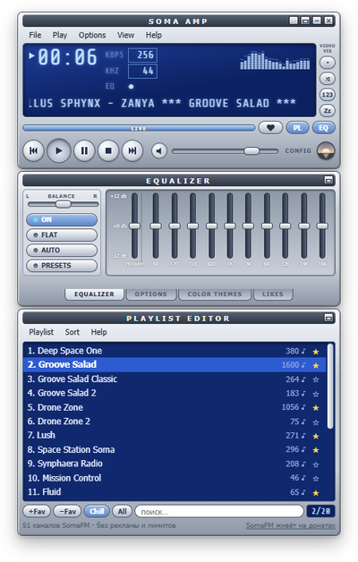

# Soma Amp

Плеер интернет-радио [SomaFM](https://somafm.com/) в стиле Winamp 5 для Windows, macOS и Linux. Веб-версия: [deemmoor.ru/soma](https://deemmoor.ru/soma/).

> Soma Amp — неофициальный плеер, с SomaFM он не связан. SomaFM — независимое радио без рекламы, которое живёт на пожертвования слушателей: [поддержать SomaFM](https://somafm.com/support/).

## Установка

Установщики лежат на странице [Releases](https://github.com/DeemMoor/soma-amp/releases/latest):

| ОС | Файл |
|---|---|
| Windows 10/11 | `*_x64-setup.exe` (без прав администратора) или `*.msi` |
| macOS (Apple Silicon) | `*_aarch64.dmg` |
| macOS (Intel) | `*_x64.dmg` |
| Linux | `*.AppImage`, `*.deb` или `*.rpm` |

Остальные файлы (`.sig`, `.tar.gz`, `latest.json`) нужны для автообновления. Новую версию программа ставит сама: Help → «Проверить обновления…».

Программа не подписана платным сертификатом, поэтому при первом запуске система предупредит:

- **Windows:** «Windows защитила ваш компьютер» → «Подробнее» → «Выполнить в любом случае».
- **macOS:** правый клик по программе → «Открыть». Если пишет «повреждена»: `xattr -cr "/Applications/Soma Amp.app"`.
- **Linux:** `.AppImage` нужно сделать исполняемым (`chmod +x`). Глобальные медиаклавиши работают в X11, в Wayland — в зависимости от окружения.

## Возможности

- Все каналы SomaFM, избранное, поиск
- Эквалайзер на 10 полос с пресетами, свой для каждого канала, визуализация спектра
- Цветовые темы, shade-режим, окно без рамки
- Лайки треков с поиском в YouTube, Яндекс Музыке и Spotify
- Трей и глобальные медиаклавиши, работают при свёрнутом окне
- Таймер сна: стоп, сон или выключение компьютера (с отменой)
- «Поверх всех окон», автозапуск с системой

| 16 цветовых тем | Эквалайзер с пресетами |
|---|---|
|  |  |

## Горячие клавиши

| Клавиша | Действие |
|---|---|
| <kbd>X</kbd> / <kbd>C</kbd> / <kbd>V</kbd> | играть / пауза / стоп |
| <kbd>Пробел</kbd> | играть / пауза |
| <kbd>Z</kbd> / <kbd>B</kbd> | предыдущий / следующий канал |
| <kbd>S</kbd> | случайный канал |
| <kbd>↑</kbd> / <kbd>↓</kbd> / <kbd>M</kbd> | громкость / без звука |
| <kbd>L</kbd> | лайк текущему треку |
| <kbd>T</kbd> | таймер сна: выкл → 15 → 30 → 60 → 90 мин |
| <kbd>Alt</kbd>+<kbd>G</kbd> / <kbd>Alt</kbd>+<kbd>E</kbd> | эквалайзер / плейлист |
| <kbd>Alt</kbd>+<kbd>X</kbd> | выход |

Работают и в русской раскладке.

## Проблемы

Help → «Сообщить о проблеме…» откроет на GitHub черновик с версией программы и концом журнала ошибок.

## Лицензия

[MIT](LICENSE). Сборка и устройство — в [docs/DEVELOPMENT.md](docs/DEVELOPMENT.md).
